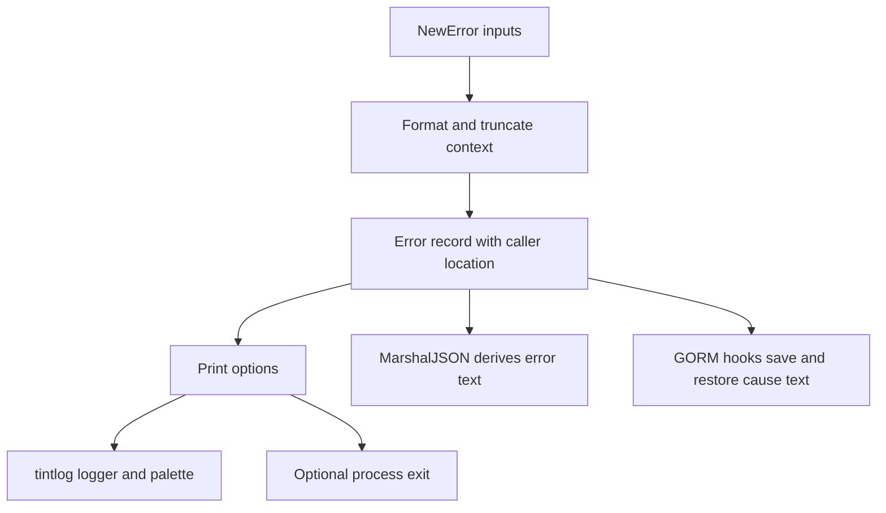

# xerr

xerr attaches a message, cause, source location, and formatted context to diagnostic records in Go. It prints through [tintlog](https://github.com/tuumbleweed/tintlog) and provides JSON encoding and GORM persistence hooks.

## Features

- Fields: `Msg`, `Where`, `Context`, `Err`, and serialized `ErrStr`.
- Context formatting for strings, bytes, JSON, errors, stringers, and arbitrary values.
- Text truncation at 64 KiB plus a notice; non-UTF-8 byte slices use a 4 KiB hex preview.
- Error, warning, and skip color themes, with optional context and a stack captured when printing.
- GORM `BeforeSave` and `AfterFind` hooks for saving error text and restoring a generic cause.



## Installation

The module declares Go 1.25.5 and depends on tintlog v0.0.9 and GORM v1.31.1.

```sh
go get github.com/tuumbleweed/xerr@v0.0.3
```

## Usage

```go
package main

import (
    "encoding/json"
    "errors"
    "fmt"

    tl "github.com/tuumbleweed/tintlog/logger"
    "github.com/tuumbleweed/xerr"
)

func main() {
    e := xerr.NewError(errors.New("connection refused"), "initialization failed",
        map[string]any{"retries": 3})
    e.PrintWithContext(xerr.ErrorTypeError, tl.Critical, 0)
    data, err := json.Marshal(e)
    if err != nil {
        panic(err)
    }
    fmt.Println(string(data))
}
```

`Print` omits context and stack; `PrintWithContext` includes both. A positive `stopCode` exits the process after printing. Nil `*Error` receivers are ignored by printing. The standalone helpers in `init.go` ignore nil causes.

The existing demo can be run from the repository root:

```sh
go run ./examples
```

It passes stop code `1`, so it terminates with a nonzero status despite its “no exit” comment.

## Serialization and limitations

`MarshalJSON` derives the `err` JSON field from `Err`. GORM saves that text and reconstructs an `errors.New` cause on reads. JSON decoding has no corresponding custom restoration hook. Database driver configuration and schema management belong to consuming applications.

`*xerr.Error` is a diagnostic container: it has neither `Error() string` nor `Unwrap() error`. Use its `Err` field when a standard Go error is required. Direct `NewError` calls capture their caller; convenience constructors currently capture an internal helper location. The output cap applies after formatting and does not bound formatting memory or execution time. Context is not redacted.

## Status and license

The original README describes the API as stable for everyday use. The repository contains no automated tests or CI configuration; this proposed README's commands and example were checked against source, not executed. Email delivery is not implemented. See the root `LICENSE` for the MIT license text.
