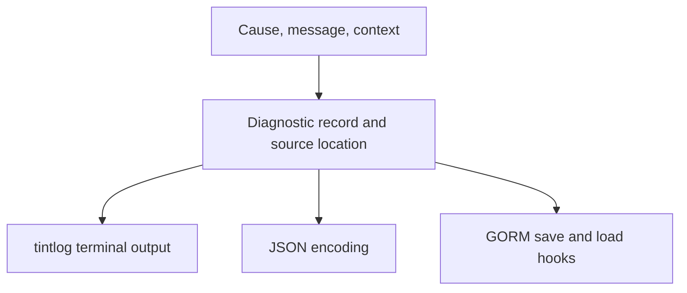

# xerr

## Overview

xerr is a small Go library for attaching diagnostic information to an underlying error: an explanatory message, source location, and formatted context. It supports colored terminal output through tintlog, JSON encoding, and GORM persistence hooks.

## My Contributions

The repository demonstrates implementation of the diagnostic record, type-aware context formatting, serialization and persistence adapters, and printing helpers. Context handling covers strings, UTF-8 and binary byte slices, raw JSON, errors, and stringers, with JSON and Go-value fallbacks. Large formatted contexts are truncated, and binary data uses a limited hex preview. Tintlog supplies the logging and color primitives; GORM supplies the persistence framework.

## Architecture

The record retains the original cause in memory and a textual representation for serialization. Database reads reconstruct a generic error from its saved text; original error types are not preserved.

## Technical Challenges

The library balances readable context with output size using small-JSON indentation, a 64 KiB text cutoff plus a truncation notice, and a 4 KiB binary preview. A method-free alias prevents recursive JSON marshaling. Printing separates message, cause, location, optional context, and a stack captured at print time.

## Results and Current State

The repository includes a demonstration program and an MIT license. The root README describes the API as stable, consistent with the developer's account of mostly completed development. There are no automated tests or CI files in the inspected tree; runtime behavior was not executed for this analysis. The record does not implement Go's `error` interface, and email delivery is outside the implemented package.

## Development History

Observed Git activity runs from November 10, 2025 to January 14, 2026. The implementation arrived in the initial snapshot, followed by documentation, a demo, module identity changes, licensing, and a preview. The latest commit updates the Go directive to 1.25.5. These dates describe recorded activity, not the project's actual start or end.
